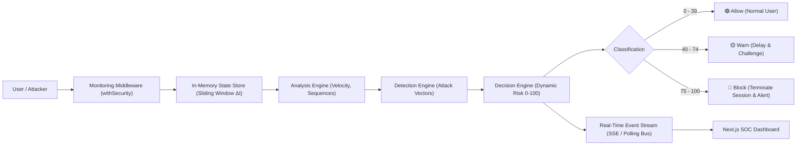

# Application-Layer Attack Detection from Internal Application State (ALAD)

[](#)
[](#)
[](#)
[](#)

A real-time cybersecurity defense system that monitors user behavior and **internal application state** to detect and neutralize stealthy application-layer attacks (such as **Account Enumeration / IDOR**, **Credential Stuffing**, **Privilege Escalation**, and **Bot Scraping**) that completely bypass traditional perimeter Web Application Firewalls (WAFs).

Unified into a production-ready **Next.js App Router** architecture ready for **1-click deployment on Vercel**.

---

## 📌 Problem Statement

Traditional security tools (Network IDS, Firewalls, and WAFs) focus on network packets and HTTP payload syntax (e.g., regex matching for `' OR 1=1` or `<script>` tags). 

However, modern attackers exploit **business logic flaws and internal object references**:
- In an **Account Enumeration (IDOR) attack**, an attacker queries:
  $$\text{Account } 101 \to 102 \to 103 \to 104 \to 105$$
  Every single request is syntactically pristine HTTP and returns a normal `200 OK`. A perimeter WAF will **never** block this!
- In **Distributed Credential Stuffing**, requests mimic legitimate user logins across accounts.
- In **Privilege Escalation Probing**, authenticated users probe hidden administrative routes.

**ALAD solves this by moving detection inside the application state**, tracking access sequences, velocity, session fingerprints, and error rates in real time.

---

## 🏗️ System Workflow & Architecture

```
User Activity ──▶ Data Collection ──▶ Behavior Analysis ──▶ Threat Detection ──▶ Decision Engine ──▶ Allow / Warn / Block
 (HTTP / API)    (Monitor Interceptor)   (State Engine Δt)      (Rule & Heuristics)   (Risk Score 0-100)      (Enforcer)
```



---

## 🎯 User Classification & Risk Scoring Model

The risk score $S(t) \in [0, 100]$ is computed dynamically over an active sliding window $\Delta t$ (60 seconds) with time-decay for benign activity:

$$S(t) = \min\left(100, \max\left(0, \sum_{i} w_i \cdot f_i(t) - \lambda \cdot (t - t_{\text{last\_violation}})\right)\right)$$

| Score Range | Classification | Action Taken | Real-Time Response |
|---|---|---|---|
| **0 – 39** | 🟢 **Normal User** | **ALLOW** | Processed without latency or disruption. |
| **40 – 74** | 🟡 **Suspicious User** | **WARN** | Injects `X-Security-Risk: suspicious` header, throttles response by 350ms, flags session in UI. |
| **75 – 100** | 🔴 **Attacker** | **BLOCK & ALERT** | Invalidates active JWT, terminates session with `HTTP 403 Forbidden`, dispatches high-priority alert to SOC Dashboard. |

---

## 🛡️ Detected Attack Vectors

1. **Account Enumeration / IDOR Sweep**:
   - Detects sequential access to monotonically incrementing/decrementing resource IDs ($101 \to 102 \to 103 \to 104 \to 105$).
2. **Credential Stuffing & Distributed Brute Force**:
   - Monitors failed authentication bursts (`401 Unauthorized`) across varied usernames within the sliding window.
3. **Privilege Escalation Probing**:
   - Detects non-administrative users attempting unauthorized access to `/api/admin/*` endpoints.
4. **Hyper-Velocity Bot Scraping**:
   - Flags superhuman navigation velocities ($> 15\text{ req}/3\text{s}$ or inter-request delay $< 80\text{ms}$).
5. **Session Hijacking / Fingerprint Anomaly**:
   - Flags sudden User-Agent or IP switching on an active session token.

---

## 💻 Tech Stack

- **Framework**: Next.js 14 (App Router)
- **Frontend**: React 18, Tailwind CSS, Lucide Icons
- **Backend & Security**: Next.js API Route Handlers, JWT, Bcrypt
- **Real-Time Telemetry**: Server-Sent Events (SSE) + EventBus (Vercel-compatible)
- **Database**: MongoDB (Mongoose ODM) with cached connection pooling + zero-config in-memory fallback store

---

## 🚀 Quick Start Guide

### 1. Installation
```bash
npm install
```

### 2. Seed Database
Seeds accounts (`101` – `106`) and test users (`alice`, `bob`, `admin`):
```bash
npm run seed
```

### 3. Run Automated Security Test Suite
Verifies all 19 security detection test cases against the Next.js API:
```bash
npm test
```
All tests pass:
- ✅ System health check
- ✅ Normal user behavior (🟢 Allow)
- ✅ Account enumeration detection (101 $\to$ 105 sweep flagged & blocked 🔴)
- ✅ SOC incident recording & 1-click admin unblock
- ✅ Credential stuffing burst blocked
- ✅ Privilege escalation probing blocked

### 4. Start Next.js Development Server
```bash
npm run dev
```
Open **`http://localhost:3000`** in your browser.

---

## ☁️ Deploying to Vercel

This repository is configured for zero-configuration Vercel deployment:

1. Push your repository to **GitHub / GitLab / Bitbucket**.
2. Go to **[vercel.com](https://vercel.com)** & click **"Add New Project"**.
3. Import this repository.
4. *(Optional)* In **Environment Variables**, configure:
   - `MONGODB_URI`: Your MongoDB Atlas connection string (if omitted, the system automatically uses the persistent in-memory database store).
   - `JWT_SECRET`: Any custom secret string for session signing.
5. Click **Deploy**.

Vercel will detect Next.js automatically and build the project in seconds.

---

## 🎮 Interactive Demonstration Walkthrough

Open the web app in your browser (`http://localhost:3000` or your Vercel URL):

1. **Demo Banking App Tab**:
   - Logged in as customer **Alice Smith** (Account `#101`).
   - Notice the status badge at top right: `🟢 NORMAL (0)`.
   - In the **Account Inspector Tool**, probe accounts `#101`, `#102` (Status remains normal).
   - Probe `#103` (Risk increases to `🟡 SUSPICIOUS (50)` with delay and warning banner).
   - Probe `#104`, `#105` $\to$ **Immediate Red Security Lockout!** (`🔴 ATTACKER BLOCKED`).
2. **SOC Dashboard Tab**:
   - View the **Live Threat Radar** streaming real-time requests with color-coded risk levels.
   - Inspect the **Active Sessions Matrix** and watch user risk bars update live.
   - Check the **Forensic Incident Registry**: inspect the exact sequence (`101 -> 102 -> 103 -> 104 -> 105`) and click **"Resolve & Unblock Client"** to restore access.
3. **Attack Simulator Tab**:
   - Run preset attack scripts with 1 click:
     - 🚀 Account Enumeration ($101 \to 105$)
     - 🔑 Credential Stuffing Spray
     - 🛡️ Privilege Escalation Probing
     - ⚡ Hyper-Velocity Scraping
   - Watch the interactive terminal console display real-time HTTP transitions from `200 OK` to `403 FORBIDDEN`.

---

## 📄 License
MIT
